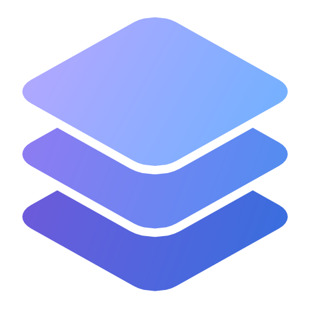

<div align="center">



# Strata UI

**A new layer on top of Windows 11.**
Your own taskbar, system tray, Start menu, flyouts and notification center, plus a Hub to
customize and optimize Windows, all in one app.

[](https://github.com/Derpchees/StrataUI/releases/latest)
[](https://github.com/Derpchees/StrataUI/releases)


</div>

---

Strata UI runs **on top of File Explorer**: your files, desktop and apps keep working exactly as
before, while Strata UI hides the native taskbar, Start menu and flyouts and draws its own. Close it
and everything goes back to normal.

> Formerly known as **WINX** (up to v1.3). Updating from WINX keeps your settings, pins and
> startup options.

## Download

1. Grab `StrataUI-Setup-X.Y.Z.exe` from the [latest release](https://github.com/Derpchees/StrataUI/releases/latest).
2. Run it and follow the wizard. You can pick the folder and install it just for you (no admin
   rights) or for every user.
3. That's it. Everything it needs is bundled, so there's no need to install .NET. The Hub
   checks for updates and installs them for you.

## Features

| | |
|---|---|
| ✏️ **Edit mode** | Lay out every monitor right on the screen: an overlay shows your wallpaper with the bars, widgets and a sample notification as they will look. Drag items between bars, edges and monitors, add new ones from the library (also from the Hub), move widgets and the notification banner anywhere, and right-click a bar for its size, style (with a color picker) and quick spots for Start and open apps, or an item for its options (clock seconds and date, battery percent, temperatures, FPS monitor…). Nothing changes until you apply it; Esc cancels. Right-click the taskbar › *Edit layout…* or run `StrataUI.exe --edit`. |
| 🧭 **Taskbar** | Up to four bars per monitor, one on each edge (top and bottom bars keep the corners), with any size, and each with its own style: the theme's, fully transparent (text adapts to the wallpaper) or a color of your own. Pinned apps, live window previews, drag to reorder (what you drag follows your pointer), group by app with stacks you can see in any theme, click an open app to minimize it, end task, and web apps (YouTube, WhatsApp Web…) with their own icon. |
| 🧩 **Bar items** | Choose what each bar shows, in which order and where: start, center or end of the bar, Start and open apps included (so alignment is just where you put them: tray, network, Bluetooth, brightness, volume, battery, clock, notifications, media, performance meters, internet speed). Each monitor gets its own Start menu, tray and status items, once per monitor. Drag them in edit mode or on the bar itself. |
| 🚀 **Start menu** | 7 styles (Windows 11, Profile, List, Full screen, Compact, Search only, Icons), resizable. Pinned apps with folders (drop one app on another or create an empty one), sections and free placement, and icons of any size (right-click › View); pin files, shortcuts and folders (also from the Windows 11 right-click menu); custom icons for any app. Finds Store apps, installed programs and Steam, Epic and GOG games; drag any app onto the taskbar to pin it. Update and shut down / restart when updates are pending. Opens on the monitor your mouse is on. |
| 🔔 **Notifications** | Its own notification center behind a bell on the taskbar (Win+N), banners on the monitor and corner you choose, Do not disturb, a calendar on the clock, and icons and pictures for every notification (web apps included), with color emojis, clickable links and stickers or photos. Clicking a website's notification opens its installed web app or takes you to the tab that sent it, like Windows does. Its own notification sound (or one you import), and Windows' per-app sounds muted so you only hear one. |
| 🔊 **Flyouts** | Sound (output, input, per-app volume, device options), network and Wi-Fi (with a show-password eye), Bluetooth, brightness for every monitor (DDC/CI) with Windows Night light, and battery. |
| 🎵 **Media** | Album art, title and artist on the bar for any app that reports media (Spotify, browsers, Media Player…), with optional controls. |
| 📊 **Performance** | CPU, GPU and RAM usage, temperatures and an FPS counter (frame generation aware: DLSS FG, FSR FG, Lossless Scaling…), plus one-click RAM cleanup. |
| 🕒 **Widgets** | A digital clock (with or without the date), a music visualizer and big CPU, GPU, FPS and internet speed readouts on your desktop: add, move and resize them in edit mode (any monitor); they stay visible with Show desktop. |
| 🎨 **Themes & colors** | Four styles (Mica, Translucent, Material and Fully transparent) combined with a scheme that stays when you switch style: Follow Windows, Light, Dark or a color scheme (Midnight OLED, Nord, Dracula, Catppuccin, Tokyo Night, Rosé Pine, Gruvbox). Accent from Windows, your own or taken from the wallpaper (Wallpaper Engine too); custom panel colors with opacity. Six animation styles and three speeds for flyouts, the Start menu, notifications, menus, the tray, window previews and taskbar buttons, and Windows' own window animations follow your choice. One theme for every monitor. |
| ⚙️ **Optimization** | One-click junk cleanup (temp files, crash dumps, update caches… never the Recycle Bin), performance, preinstalled apps, privacy, AI features, Windows Update, Explorer and more, always with a backup so you can undo everything. It's an optional module: install it from the Hub with one click. Installed for all users, it applies changes without UAC prompts. |
| 🧱 **Modules** | Import themes, animations, desktop widgets, Start menu looks (small declarative JSON files that can't run code) and notification sounds from one place in the Hub. Export and import all your Strata UI settings as a .zip. See [the module format](docs/modules/README.md). |
| 🌐 **Languages** | English, Spanish, Portuguese, French and German, following Windows or chosen in the Hub. Drop a `xx.json` into `%LOCALAPPDATA%\StrataUI\Languages` to add your own. |

Right-click an empty spot on the bar for **Strata UI settings** (the Hub) or **Exit Strata UI**
(brings back the Windows taskbar).

## Building from source

Requirements: Windows 11 and the [.NET 10 SDK](https://dotnet.microsoft.com/download)
(`winget install Microsoft.DotNet.SDK.10`).

```powershell
.\scripts\run.ps1                         # closes Strata UI if it's running, builds and relaunches it
dotnet test tests\Strata.Tests -c Release  # tests (xUnit)
.\scripts\build-installer.ps1             # artifacts\StrataUI-Setup-X.Y.Z.exe (needs Inno Setup 6)
```

### Command line

| Argument | What it does |
|---|---|
| *(none)* | Starts Strata UI; if it's already running, opens the Hub. Strata UI also has its own tray icon: click it for the Hub, right-click to edit the layout, restart or exit. |
| `--autostart` | Used when Windows starts: doesn't open the Hub (unless *Open the Hub when Windows starts* is on in Hub › General). |
| `--hub <page>` | Opens the Hub on a page: `Dashboard`, `Taskbar`, `Tray`, `Flyouts`, `Start`, `Notifications`, `Appearance`, `Import`, `General`, `Updates`, `Privacy`, `Backup`… |
| `--edit` | Opens edit mode (in the running instance, or right after starting). |
| `--exit` | Cleanly closes the running instance (and waits for it). |
| `--restore-taskbar` | Emergency: shows the Windows taskbar again if Strata UI didn't close properly. |

Other arguments (`--apply-tweak`, `--sensors-task`, `--pick`…) are internal: Strata UI launches
itself with them for elevated tasks and helper processes.

### Where data lives

Everything is in `%LOCALAPPDATA%\StrataUI\`: `settings.json` (preferences), `tweaks-backup.json`
(original values before each optimization) and `logs\strataui.log`.

### Project layout

```
src/Strata.Shell/
  App.xaml(.cs)        Startup, single instance, shell lifetime
  Taskbar.xaml(.cs)    The taskbar (one or two per monitor)
  Controls/            Task button, tray icon, window previews
  Flyouts/             Sound, network, Bluetooth, brightness, battery, notification center
  Notifications/       Notification banners and on-screen indicators (OSD)
  StartMenu/           Start menu styles, pins with folders and sections
  Hub/                 Settings window and its pages
  Tweaks/              Optimization engine, catalog, backup, Appx apps, elevation
  Services/            Settings, audio, network, Bluetooth, brightness, notifications, sensors,
                       updates, themes, localization
  Localization/        UI translations (en.json; Spanish lives in the code)
src/Strata.Optimization/  Optional module with the Optimization pages (downloaded from the Hub)
tests/Strata.Tests/    xUnit tests
installer/             Inno Setup script
scripts/               run.ps1, build-installer.ps1
```

Versions follow [semantic versioning](https://semver.org/); every release is listed in the
[changelog](CHANGELOG.md) (in Spanish) and tagged `vX.Y.Z`.

## Credits

- [ManagedShell](https://github.com/cairoshell/ManagedShell): taskbar, tray and AppBar plumbing.
- [WPF-UI](https://github.com/lepoco/wpfui): Fluent controls for the Hub and flyouts.
- [NAudio](https://github.com/naudio/NAudio): Core Audio access.
- [LibreHardwareMonitor](https://github.com/LibreHardwareMonitor/LibreHardwareMonitor): temperatures.
- Optimization options inspired by [Win11Debloat](https://github.com/Raphire/Win11Debloat) (MIT).
